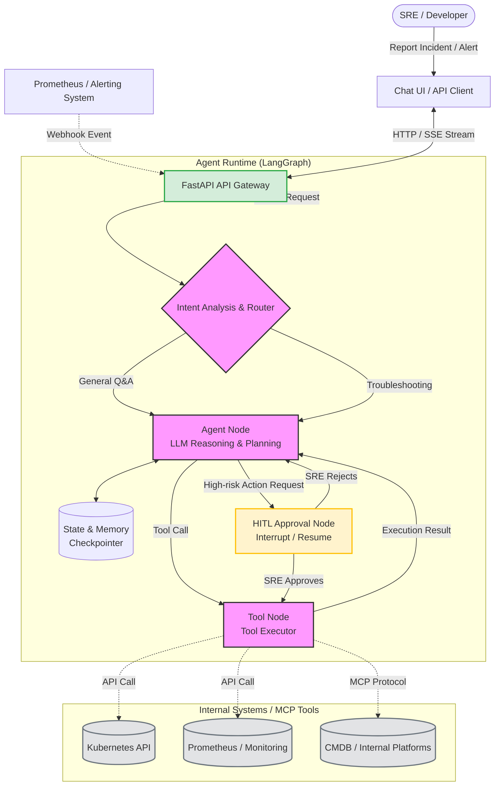

# SRE Meta Agent (Enterprise MVP) 🚀

[](https://www.python.org/)
[](https://fastapi.tiangolo.com/)
[](https://python.langchain.com/docs/langgraph)
[](https://opensource.org/licenses/MIT)

An **Enterprise-grade AI Agent Platform** designed for R&D efficiency and SRE (Site Reliability Engineering) troubleshooting. Powered by Large Language Models (LLMs) and tailored for Kubernetes operations, this project implements an Agent Runtime with **stateful memory, SSE streaming, event-driven triggers, and tool calling**.

## ✨ Core Features

- **LangGraph-based Orchestration**: Utilizes `StateGraph` to manage multi-turn conversation states and conditional routing, ensuring a deterministic control flow rather than black-box generation.
- **Real-time Streaming (SSE)**: Integrates Server-Sent Events to stream LLM thought processes and tool execution statuses directly to the frontend, eliminating the "waiting in the dark" UX during complex troubleshooting.
- **Event-Driven AIOps (Webhook)**: Exposes a dedicated endpoint to ingest Prometheus Alertmanager webhooks, allowing the Agent to autonomously perform first-round triage without human intervention.
- **Standardized Tool Calling**: Encapsulates internal system capabilities (e.g., K8s log retrieval) as standard tools, enabling LLM-driven automated troubleshooting.
- **Context & State Management**: Integrates `MemorySaver` Checkpointer mechanisms to ensure context continuity and fault recovery for long-running tasks.
- **Chaos Engineering & Resilience**: Includes a basic chaos testing skeleton to verify graceful degradation under abnormal inputs or tool failures.

## 🧠 System Architecture



## 🛠️ Getting Started

### 1. Clone the Repository
```bash
git clone https://github.com/your-username/sre-meta-agent.git
cd sre-meta-agent
```

### 2. Environment Setup & Installation
This project supports both `Conda` and `venv`. **Windows users are highly recommended to use Conda** to avoid `pydantic-core` compilation errors.

<details>
<summary><b>Option 1: Using Conda (Recommended for Windows)</b></summary>

Due to network conditions in China, if you encounter a `pkgs/pro` 404 error, please copy the `.condarc.example` from the project root to `C:\Users\<YourUsername>\.condarc`, clear the cache, and then run:

```bash
# 1. Clear cache and create a Python 3.11 environment
conda clean -i -y
conda create -n sre-meta-agent python=3.11 -y

# 2. Activate the environment
conda activate sre-meta-agent

# 3. Install dependencies
pip install -r requirements.txt
```
</details>

<details>
<summary><b>Option 2: Using Python venv</b></summary>

```bash
python -m venv .venv

# Windows activation: .venv\Scripts\activate
# Mac/Linux activation: source .venv/bin/activate
source .venv/bin/activate

pip install -r requirements.txt
```
</details>

### 3. Configuration
Copy the example environment file and fill in your LLM API Key:
```bash
cp .env.example .env
```
Edit the `.env` file:
```env
# Any model compatible with the OpenAI interface works (e.g., DeepSeek, Qwen)
OPENAI_API_KEY=sk-your-real-api-key
OPENAI_API_BASE=https://api.openai.com/v1
```

### 4. Running the Service
```bash
uvicorn main:app --reload
```
Once the service is up, visit the Swagger UI for testing: **http://127.0.0.1:8000/docs**

---

## 🧪 Testing Scenarios

Because the primary endpoint uses **Server-Sent Events (SSE)**, standard Swagger UI may not render the stream correctly. Use the `curl` commands below to test the platform.

### Scenario 1: Interactive Troubleshooting (Chat Stream)
Open your terminal and run:

```bash
curl -N -X POST "http://127.0.0.1:8000/api/v1/chat/stream" \
-H "Content-Type: application/json" \
-d '{
  "message": "The pod payment-service-error is crashing. Please check the logs.",
  "session_id": "sre-troubleshoot-001"
}'
```

#### What you should see:
Because local models are slower, you will see the stream pause for a few seconds, and then output:

```text
data: {"type": "status", "content": "Executing tool: get_pod_logs..."}
data: {"type": "token", "content": "Based on "}
data: {"type": "token", "content": "the logs, "}
...
data: {"type": "token", "content": "the container is OOMKilled."}
data: [DONE]
```

**Expected Agent Behavior**:
1. You will see real-time SSE events (`data: {"type": "status"}`) indicating the Agent is executing the `get_pod_logs` tool.
2. The tool returns mock `OOMKilled` error logs.
3. You will see the LLM stream its final analysis (`data: {"type": "token"}`) with remediation advice (e.g., adjusting JVM memory).

### Scenario 2: Automated AIOps (Prometheus Webhook)
Simulate an alert firing from Prometheus Alertmanager:

```bash
curl -X POST "http://127.0.0.1:8000/api/v1/webhook/prometheus" \
-H "Content-Type: application/json" \
-d '{
  "status": "firing",
  "alerts": [
    {
      "fingerprint": "local-123",
      "annotations": {"summary": "Pod payment-service-oom OOMKilled."}
    }
  ]
}'
```
*Note: The endpoint will immediately return `200 OK`. The Agent will analyze the incident asynchronously via FastAPI BackgroundTasks.*

---

## 🗂️ Project Structure

```text
sre-meta-agent/
├── .env.example
├── requirements.txt
├── main.py                     # FastAPI Entry Point
├── app/
│   ├── api/                    # API Routing Layer
│   │   ├── chat.py             # SSE Streaming endpoints
│   │   └── webhook.py          # Prometheus Alertmanager Webhook ingestion
│   ├── core/                   # Agent Runtime & LangGraph
│   │   ├── graph.py            # Graph compilation (Router, Planner, ToolExec)
│   │   ├── state.py            # AgentState definition
│   │   └── memory.py           # Checkpointer (MemorySaver setup)
│   ├── services/               # Business Logic
│   │   ├── llm.py              # LLM initialization & Tool binding
│   │   └── prompts.py          # SRE System Prompts
│   ├── tools/                  # Tool Layer
│   │   └── k8s_tools.py        # K8s get_logs, restart_pod
│   └── schemas/                # Pydantic Models
│       └── payloads.py         # ChatRequest, WebhookPayload
├── tests/                      # Unit & Resilience Tests
│   ├── test_graph.py
│   └── chaos/
└── deploy/
    └── Dockerfile
```

## 🧪 Running Unit Tests

```bash
pytest tests/ -v
```

## 🗺️ Roadmap

This is an Enterprise MVP. Future evolutions toward a fully production-ready platform include:
- [ ] **Persistent Storage**: Upgrade `MemorySaver` to `PostgresSaver` or `RedisSaver` to support distributed state sharing across multiple instances.
- [ ] **Human-in-the-Loop (HITL)**: Implement LangGraph's `interrupt_before=["tools"]` to pause execution before high-risk operations (like `restart_pod`) and wait for API-based approval.
- [ ] **MCP Protocol Integration**: Introduce the Model Context Protocol for dynamic discovery and integration of external enterprise tools.
- [ ] **Observability**: Integrate OpenTelemetry or LangSmith to monitor token consumption and inference latency.