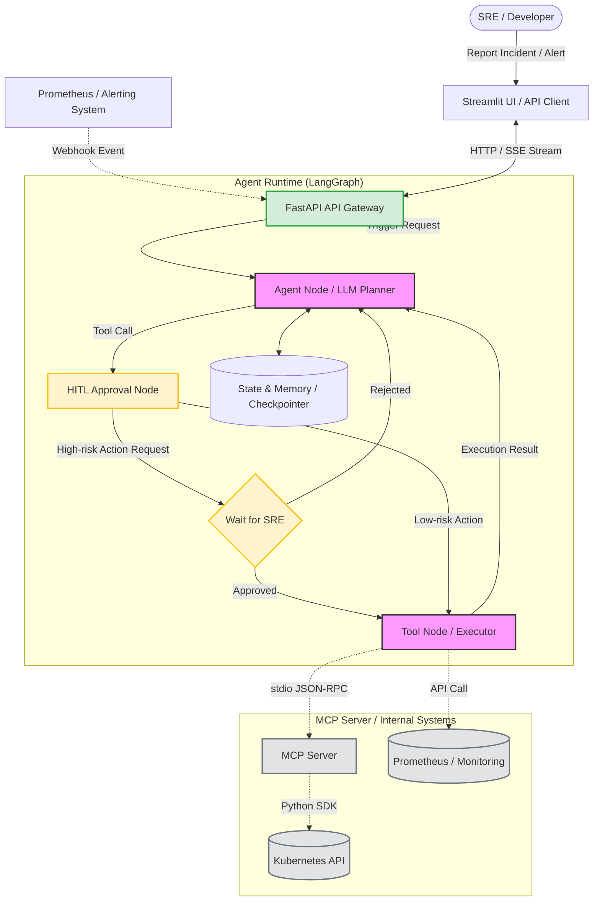

# SRE Meta Agent (Enterprise Platform)

[](https://www.python.org/)
[](https://fastapi.tiangolo.com/)
[](https://python.langchain.com/docs/langgraph)
[](https://modelcontextprotocol.io/)
[](https://opensource.org/licenses/MIT)

An **Enterprise-grade AI Agent Platform** designed for R&D efficiency and SRE (Site Reliability Engineering) troubleshooting. Powered by Large Language Models (LLMs) and tailored for Kubernetes operations, this project implements a secure Agent Runtime with **stateful memory, SSE streaming, MCP tool execution, and Human-in-the-Loop (HITL) safety boundaries**.

## Core Features

- **LangGraph-based Orchestration**: Utilizes `StateGraph` to manage multi-turn conversation states and conditional routing, ensuring a deterministic control flow rather than black-box generation.
- **True Human-in-the-Loop (HITL)**: Implements LangGraph's dynamic `interrupt()` API. High-risk operations (e.g., `restart_pod`, `apply_yaml_manifest`) pause the graph and require SRE approval via the frontend before execution.
- **Model Context Protocol (MCP)**: Decouples tool execution from the core agent logic. A standalone K8s MCP Server is spawned via `stdio`, exposing standard tools for real cluster interaction.
- **Real Kubernetes Integration**: Connects to Minikube/kind or production clusters using the official `kubernetes` Python SDK. Supports log retrieval, event diagnosis, and raw `kubectl` commands.
- **Real-time Streaming (SSE)**: Streams LLM thought processes and tool execution statuses directly to the Streamlit frontend.
- **Event-Driven AIOps (Webhook)**: Exposes a dedicated endpoint to ingest Prometheus Alertmanager webhooks for autonomous first-round triage.
- **Cross-Platform & Enterprise Standards**: Enforces ASCII-only English logging (`[INFO]`, `[ERROR]`, `[WARN]`) for compatibility with RHEL9 and CI/CD log parsers.

## System Architecture



## Getting Started

### 1. Clone the Repository
```bash
git clone https://github.com/your-username/sre-meta-agent.git
cd sre-meta-agent
```

### 2. Environment Setup & Installation
This project supports both `Conda` and `venv`. **Windows users are highly recommended to use Conda** to avoid `pydantic-core` compilation errors.

<details>
<summary><b>Option 1: Using Conda (Recommended for Windows)</b></summary>

If you encounter a `pkgs/pro` 404 error, copy the `.condarc.example` from the project root to `C:\Users\<YourUsername>\.condarc`, clear the cache, and run:

```bash
conda clean -i -y
conda create -n sre-meta-agent python=3.11 -y
conda activate sre-meta-agent
pip install -r requirements.txt
```
</details>

<details>
<summary><b>Option 2: Using Python venv</b></summary>

```bash
python -m venv .venv
# Windows: .venv\Scripts\activate
# Mac/Linux: source .venv/bin/activate
source .venv/bin/activate
pip install -r requirements.txt
```
</details>

### 3. Configuration
Copy the example environment file and fill in your configuration:

```bash
cp .env.example .env
```

Edit the `.env` file:
```env
# LLM Configuration (Options: openai, ollama, deepseek)
LLM_PROVIDER=ollama
LLM_MODEL_NAME=qwen2.5:7b
OLLAMA_BASE_URL=http://localhost:11434

# Backend Configuration
BACKEND_API_URL=http://127.0.0.1:8000

# Kubernetes Configuration
# Absolute path to your kubeconfig file (e.g., C:/Users/KUN/.kube/config)
KUBECONFIG_PATH=~/.kube/config
```

*Note: Ensure `kubectl` is installed and configured in your environment, as the MCP Server relies on the Kubernetes Python SDK which reads the same configuration.*

### 4. Running the Service

You can run the application locally or via Docker Compose. 

**Local Development:**
```bash
# Terminal 1: Start FastAPI Backend
uvicorn main:app --reload

# Terminal 2: Start Streamlit Frontend
streamlit run frontend/app.py
```

**Docker Compose:**
```bash
docker-compose up -d --build
```
*Access the UI at `http://localhost:8501` and the API at `http://localhost:8000`.*

---

## Testing Scenarios

### Scenario 1: High-Risk Operation with HITL (UI)
1. Open the Streamlit UI at `http://localhost:8501`.
2. Enter the prompt: *"The pod crash-pod is not working. Please check the logs and restart it."*
3. **Expected Behavior**:
   - The Agent calls `get_pod_logs` (low risk) and gets real K8s logs.
   - The Agent attempts to call `restart_pod` (high risk).
   - The graph pauses. The UI displays an approval card: `[APPROVE] Execute` / `[REJECT] Cancel`.
   - Click **Approve** to resume the graph and trigger the actual K8s deletion/recreation.

### Scenario 2: Interactive Troubleshooting (API / SSE)
Because the primary endpoint uses Server-Sent Events (SSE), standard Swagger UI may not render correctly. Use `curl`:

```bash
curl -N -X POST "http://127.0.0.1:8000/api/v1/chat/stream" \
-H "Content-Type: application/json" \
-d '{
  "message": "List all failed pods in the default namespace.",
  "session_id": "sre-test-001"
}'
```

**Expected Output**:
```text
data: {"type": "status", "content": "[TOOL] Executing: list_failed_pods..."}
data: {"type": "token", "content": "The following pods are failing: "}
data: {"type": "token", "content": "crash-pod (Pending). "}
data: [DONE]
```

### Scenario 3: Automated AIOps (Prometheus Webhook)
Simulate an alert firing from Prometheus Alertmanager:

```bash
curl -X POST "http://127.0.0.1:8000/api/v1/webhook/prometheus" \
-H "Content-Type: application/json" \
-d '{
  "status": "firing",
  "alerts": [
    {
      "fingerprint": "local-123",
      "annotations": {"summary": "Pod crash-pod OOMKilled."}
    }
  ]
}'
```
*The endpoint returns `200 OK` immediately, and the Agent analyzes the incident asynchronously via FastAPI BackgroundTasks.*

---

## Project Structure

```text
sre-meta-agent/
├── .env.example
├── docker-compose.yml
├── requirements.txt
├── main.py                     # FastAPI Entry Point (Lifespan MCP Loader)
├── frontend/
│   └── app.py                  # Streamlit UI (Chat & HITL Approval)
├── mcp_servers/
│   └── k8s_server.py           # Standalone MCP v2 Server for K8s operations
├── app/
│   ├── api/                    # API Routing Layer
│   │   ├── chat.py             # SSE Streaming & Approval endpoints
│   │   └── webhook.py          # Prometheus Alertmanager Webhook
│   ├── core/                   # Agent Runtime & LangGraph
│   │   ├── graph.py            # Graph compilation (Planner, Approval, ToolExec)
│   │   └── state.py            # AgentState definition
│   ├── services/               # Business Logic
│   │   ├── llm.py              # LLM Factory (OpenAI, Ollama, etc.)
│   │   └── prompts.py          # SRE System Prompts
│   └── schemas/                # Pydantic Models
│       └── payloads.py         
├── tests/                      # Unit & Resilience Tests
└── deploy/                     # Dockerfiles for Backend & Frontend
```

## Running Unit Tests

```bash
pytest tests/ -v
```

## Roadmap

Completed in v0.2.0:
- [x] **Human-in-the-Loop (HITL)**: Implemented LangGraph `interrupt()` for high-risk operations.
- [x] **MCP Protocol Integration**: Migrated tools to a standalone MCP Server (`stdio`).
- [x] **Real K8s Cluster**: Integrated official `kubernetes` SDK for actual cluster mutations and queries.

Future evolutions toward a fully production-ready platform:
- [ ] **Persistent Storage**: Upgrade `MemorySaver` to `PostgresSaver` for distributed state sharing.
- [ ] **Observability**: Integrate OpenTelemetry or LangSmith to monitor token consumption and graph execution traces.
- [ ] **CI/CD Pipeline**: Add GitHub Actions for automated testing and multi-arch Docker builds.